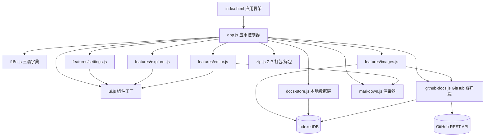

# 架构说明

## 1. 分层总览

核心原则：

- `app.js` 是**唯一控制器**，持有会话状态、装配模块、编排同步流程。
- 功能模块不直接互相引用，统一通过 `ctx` 调用控制器能力。
- 数据层 `DocsStore` 不认识网络；网络层 `GitHubDocs` 不认识业务文档结构。
- UI 组件全部由 `App.UI` 生成，便于统一改样式与行为。

## 2. 模块职责

| 模块 | 文件 | 职责 | 不负责 |
| --- | --- | --- | --- |
| 应用控制器 | `js/app.js` | 设置/绑定/文件夹/标签页/脏标记/日志状态；同步编排；ZIP 导出/导入编排；快捷键；装配模块 | 具体 DOM 组件细节 |
| 持久化层 | `js/idb.js` | IndexedDB 六仓库读写、旧 localStorage 数据迁移、禁用 IDB 时降级 | 业务语义 |
| ZIP 编解码 | `js/zip.js` | 原生 CompressionStream/DecompressionStream 打包/解包，CRC32 与 STORE 兜底 | 文件选择、业务路径 |
| GitHub 客户端 | `js/github-docs.js` | REST 调用、缓存（落 IndexedDB）、条件请求、节流队列、退避重试、文件/二进制 CRUD | 文档语义、冲突判定 |
| 本地数据层 | `js/docs-store.js` | frontmatter 解析、文档记录、pending 队列、LWW、冲突标记、Tree 快照（异步持久化） | 网络请求 |
| Markdown | `js/markdown.js` | 安全渲染 Markdown 子集、生成大纲、双链与任务项 | 编辑器交互 |
| i18n | `js/i18n.js` | 三语字典、`data-i18n` 属性扫描、语言切换通知 | 业务状态 |
| UI 工厂 | `js/ui.js` | 元素/图标/按钮/输入/菜单/弹窗/确认/提示/toast/busy | 业务数据 |
| 设置中心 | `js/features/settings.js` | 五个设置标签、GitHub 绑定流程、busy 遮罩 | 持久化实现 |
| 文件树 | `js/features/explorer.js` | 文件夹/标签/搜索树、右键菜单、拖放移动 | 文档内容编辑 |
| 编辑器 | `js/features/editor.js` | 标题/标签输入、工具栏、源码/预览分栏、大纲、冲突条 | 文件 CRUD |
| 图片 | `js/features/images.js` | 粘贴/拖放/选择图片，上传或内联 dataURL | Markdown 渲染 |

`js/config-sync.js` 是原始单文件配置同步 demo 的遗留代码。当前知识库**不使用**它的同步能力，只在 `js/idb.js:migrateLegacy()` 中读取一次 `config-sync:github-binding`，用于把旧用户的绑定迁移到 IndexedDB `kv:binding`。

## 3. ctx 契约

`app.js` 在 `init()` 中构造 `ctx` 并传给所有功能模块。新增模块时应只依赖这些字段，不要直接访问 `state` 或 `client`。

| 字段 | 类型 | 说明 |
| --- | --- | --- |
| `t(key, params)` | function | 调 `I18n.t`，所有展示文案应走这里 |
| `toast(message, type)` | function | 轻量提示，`type` 可用 `ok` / `error` / `warn` |
| `log(message)` | function | 写入状态栏日志面板 |
| `settings` | object | 当前设置对象引用（`app.js` 中 `state.settings`） |
| `setSetting(key, value)` | function | 修改并持久化设置；`maxRetries` 会触发客户端重建 |
| `applySettings()` | function | 把设置应用到 DOM（主题、字号、tabSize、工具栏、大纲） |
| `locale()` / `locales()` / `setLocale(locale)` | function | 语言能力 |
| `binding` | object | 当前绑定 `{ token, owner, repo, branch, rootDir, remember }` |
| `setBinding(binding)` | function | 持久化绑定并重建客户端 |
| `refreshClient()` | function | 用当前设置/绑定重建 `GitHubDocs` |
| `listRepos()` / `listBranches(owner, repo)` | function | 返回 Promise；内部用临时客户端处理 token 变更 |
| `getAssetDataUrl(path)` | function | 先从 IndexedDB `assets` 读取，未命中再回源 GitHub 并缓存，失败返回 `null` |
| `saveAsset(path, dataUrl, mime)` | function | 把图片 dataURL 存入 IndexedDB `assets`，返回 Promise |
| `storage` | App.Storage | 持久化层，可用 `backend()` 查询当前后端、`kvGet/kvPut/get/getAll/put/putMany/del/clear` |
| `exportFolder(folder)` / `importFolder(folder)` | function | 导出/导入文件夹 ZIP；空路径表示整个知识库 |
| `exportAll()` / `importAll()` | function | 整库导出/导入的便捷入口 |
| `offline()` | function | 返回是否离线 |
| `store` | DocsStore | 本地数据层实例 |
| `client` | GitHubDocs / null | **getter**，始终返回最新客户端 |
| `folders` | string[] | 本地文件夹路径数组 |
| `activeDoc()` / `activePath()` / `isDirty(path)` | function | 当前编辑状态查询 |
| `openDoc(path)` | function | 打开文档标签页 |
| `createDoc(folder)` / `renameDoc(path)` / `deleteDoc(path)` | function | 文档 CRUD |
| `createFolder(parent)` / `renameFolder(path)` / `deleteFolder(path)` | function | 文件夹 CRUD（空目录写 `.gitkeep`） |
| `moveDoc(oldPath, newPath)` / `moveDocPrompt(path)` | function | 移动文档（文件树拖放/右键） |
| `onEditorInput()` | function | 编辑器输入回调（更新脏标记 + 自动保存） |
| `saveActive(silent)` | function | 保存当前文档 |
| `resolveConflict(choice)` | function | 兼容旧冲突入口 |
| `showHistory(path)` | function | 打开历史版本弹窗 |
| `syncNow(force)` | function | 手动同步（拉取 + 上传） |
| `refreshExplorer()` | function | 强制刷新文件树 |
| `editor` / `images` / `explorer` / `settingsPanel` | object | 装配后回填的模块实例 |

## 4. 状态所有权

| 状态 | 持有者 | 说明 |
| --- | --- | --- |
| `settings`、`binding`、`folders`、`lastSync` | `app.js` 的 `state` | 异步从 IndexedDB `kv` 仓库加载，键 `settings` / `binding` / `folders` / `lastSync` |
| `tabs`、`activePath`、`dirty`、`logs`、`timer` | `app.js` 的 `state` | 纯内存，刷新即丢失 |
| `docs`、`pending`、`tree`、`deviceId` | `DocsStore` | IndexedDB `docs` / `pending` 仓库 + `kv` 中的 `tree` / `device` |
| 响应缓存、限流信息、请求队列 | `GitHubDocs` 实例 | 缓存落 IndexedDB `apiCache`，队列只在内存 |
| 图片二进制 | `App.Storage` / `Images` | IndexedDB `assets`，路径为仓库相对路径（如 `docs/assets/x.png`） |
| 当前语言 | `I18n` | IndexedDB `kv` 中的 `locale` |
| 草稿输入、当前视图模式、预览滚动位置 | `Editor` 模块 | 内存态，切文档时替换 |

`ctx.client` 用 `Object.defineProperty` 定义为 getter，保证设置变更或重新绑定后，各模块拿到的永远是最新客户端。

## 5. 关键数据流

### 5.1 启动流程

1. `App.Storage.init()` 打开 IndexedDB（或降级 localStorage），必要时一次性迁移旧 localStorage 数据。
2. `app.js` 异步读取 `settings` / `binding` / `folders` / `lastSync` / 语言 / API 缓存。
3. `I18n.setLocale()` → `applySettings()`。
4. 构造 `ctx`，实例化 `DocsStore`（等待其 `ready`）与 `GitHubDocs`。
5. 依次创建 Settings / Explorer / Editor / Images 模块。
6. `store.ready` 后打开最近一篇本地文档，刷新文件树、标签页、状态徽标。
7. `setTimeout(() => pullFromRemote({ push: false, silent: true }), 0)`：**只拉取，绝不上传**。
8. 若未绑定或离线，`pullFromRemote` 直接返回，零 API 调用。

### 5.2 拉取（`pullFromRemote`）

1. `client.listTree(force)` 一次拿到全量文件清单与 blob sha。
2. 把**本地 pending 的文件排到前面**，避免 `maxFetch` 截断时漏掉冲突检测。
3. 对 `sha` 变化且本地有 pending 的文档，下载远端内容并收集内容冲突。
4. 对 `doc.sha && !remoteMap[path] && pending` 的文档，收集删除冲突。
5. 若存在冲突：
   - 先用 `applyRemoteDeletion` / `markConflictWithRemote` 打标；
   - 弹窗并排展示本地/远端；
   - **整批中止**：不 `applyRemote`，不 `pushPending`；
   - 刷新文件树与状态，交由用户选择。
6. 无冲突时才 `applyRemote` 合并远端、处理远端删除，并按 `options.push` 决定是否上传本地 pending。
7. 成功后写 `docs-kb:lastSync`，更新顶部状态徽标。

注意：`listTree` 返回 `truncated: true` 时跳过“远端删除”判定，避免不完整清单误删本地文档。

### 5.3 同步（`syncNow`）

`syncNow(force)` 等价于 `pullFromRemote({ force, push: true })`。拉看无冲突后串行执行 `pushPending()`：

- `pending.op === 'upsert'` → `client.putFile(path, serialize(doc), message, doc.sha)`
- `pending.op === 'delete'` → `client.deleteFile(path, message, doc.sha)`
- 成功后 `store.markSynced(path, sha, etag)`
- 遇到 `409`：先 `client.invalidateDoc(path)` 再强制拉取远端最新内容，调用 `markConflictWithRemote`，保留本地排队状态。

### 5.4 冲突处理

冲突弹窗逐条提供三个选择：

| 选择 | 底层调用 | 效果 |
| --- | --- | --- |
| 采用远端 | `store.adoptRemote(path)` | 清 pending，使用远端内容/时间戳/sha |
| 保留本地并覆盖 | `store.keepLocal(path)` | 重打时间戳，保留 pending；远端仍存在时带远端 sha 覆盖 |
| 稍后处理 | 无 | 保留 `conflict` 标记与 `remote` 快照，状态栏显示红色 |

### 5.5 图片

1. `Images` 用 `FileReader` 读取为 dataURL，并调用 `ctx.saveAsset()` 写入 IndexedDB `assets`（离线也能保存）。
2. 已绑定时额外 `client.putBinary('assets/<时间戳-随机>.<ext>', dataURL, 'docs: upload image ...')`。
3. 按当前文档目录深度生成相对链接（如 `../assets/xxx.png`）。
4. 预览时 `Editor.hydrateImages()` 把 assets 相对路径替换为 `ctx.getAssetDataUrl()` 的 dataURL 并做内存缓存；未命中本地缓存时回源 GitHub 并写回 IndexedDB。

### 5.6 文件夹 ZIP 导出 / 导入

1. 导出：`exportArchive(folder)` 用 `DocsStore.serialize()` 把选中文件夹（含子目录）的文档写成仓库相对路径的 `.md`，按正文引用收集 `assets/*`，写 `manifest.json`（version/root/docs/folders/assets），用 `App.Zip.create()` 打包下载。
2. 导入：用户选 `.zip` → `App.Zip.read()` → 解析 manifest（无 manifest 时兼容纯 `.md` ZIP）→ 把压缩包内 `root` 前缀映射到目标文件夹 → 按新旧目录深度重写 Markdown 中的图片相对链接。
3. 同名文档弹出冲突列表，逐项或批量选择“覆盖 / 跳过”，绝不自动覆盖；其余文档直接导入。
4. 导入完成后合并文件夹列表、刷新资源管理器与标签页，并按自动同步设置排队上传。
5. `App.Zip` 使用原生 `CompressionStream('deflate-raw')` / `DecompressionStream('deflate-raw')`；不支持时写/读 STORE 包，保证零依赖与 `file://` 可用。

### 5.7 设置变更

- 普通设置：`setSetting(key, value)` 写盘 → `applySettings()` 更新 DOM。
- `maxRetries`：额外调用 `refreshClient()`，新客户端立即使用新值。
- 语言：`setLocale()` → `I18n` 通知监听者 → Explorer / Tabs / Header / Preview 重新渲染。
- GitHub 绑定：`setBinding()` 写盘（按 `remember` 决定是否持久化 token）→ 重建客户端 → 刷新文件树与状态。

## 6. 不变量（改动时必须保持）

1. **启动只拉取不上传**，冲突时整批中止。
2. **本地缓存优先**：未绑定时页面加载零 API 调用。
3. **Git Tree 一次拿全清单**，只下载 sha 变化的文档。
4. **所有 GET 走 `_get`**，使用 TTL 缓存 + ETag 条件请求 + 并发去重。
5. **所有写操作走队列**，并发上限 3、最小间隔 180ms，可重试错误按 `maxRetries` 退避。
6. **冲突绝不自动覆盖用户数据**；`keepLocal` 时要正确保留/清空 sha。
7. **`data-i18n` 文案必须三语齐全**，新增 key 同时改 zh-CN / en / ja。
8. **脚本保持经典脚本形态**，不引入 ESM/bundler，保证 `file://` 直开。
9. **持久化走 `App.Storage`**，除降级兜底外不直接读写 `localStorage`；首次启动迁移旧数据后清除旧键。
10. **导入 ZIP 遇到同名必须让用户选择覆盖或跳过**，不静默覆盖，并同步重写图片相对链接。
